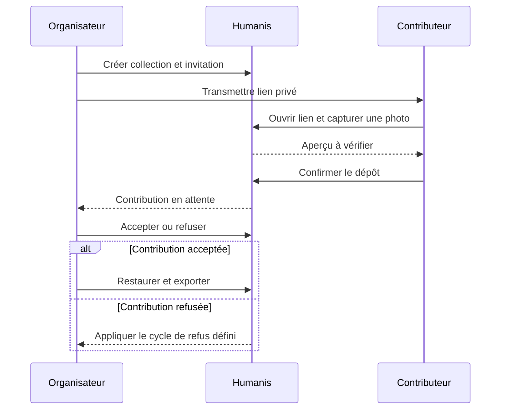

# Humanis — Design / UX-UI
Version 0.1 · 18 novembre 2026 · BROUILLON DE REVUE.
Cadre : Playbook partie 03 v1.0. Référence UX globale non encore approuvée.

## Existant 0.3.0
Inventaire dérivé du code db0a4b7, sans inspection visuelle de production pendant ce travail :
| UI | Référence | Fonction et conventions |
| --- | --- | --- |
| UI-01 | AuthGate.tsx | Entrée privée et authentification |
| UI-02 | App.tsx, ComparisonCanvas.tsx, RestorationToolbar.tsx | Studio, contexte, comparaison et téléchargement |
| UI-03 | Gallery.tsx | Galerie, import multiple, statuts, relance, historique, ZIP et suppression |
| UI-04 | BuildVersion.tsx | Version et commit affichés |

Sources dans [les références](../references.md). Direction visuelle constatée dans le code : fonds zinc sombres, textes clairs, accent ambre, cartes et bordures sobres. Elle sert de point de départ, sans valoir validation d'identité ou d'accessibilité.
Les réglages visuels et leur export ne doivent pas être présentés comme intégralement persistés : le backlog existant signale ce point.

## Principes retenus et propositions
- Priorité à la photo, comparaison explicite original/restauration et conservation de la source.
- Organisateur sur web ordinateur/mobile ; contribution occasionnelle sur smartphone.
- Entrée par lien privé ; éviter le compte obligatoire au premier écran de dépôt (direction retenue).
- Montrer précisément ce que le lien permet et qui pourra voir le dépôt.
- Importer un fichier comme alternative à la caméra.
- Aucune réutilisation imposée de l'identité graphique DEXI/EP ; mutualisation fonctionnelle à justifier.
- Messages simples, sans détails internes de file/worker.

## Architecture de l'information candidate
Espace personnel : collections et galerie → collection → photo/studio.
Espace organisateur : contexte, invitation, contributions à valider, photos acceptées.
Entrée contributeur : invitation → capture/fichier → aperçu et souvenir → confirmation du dépôt.
Le dépôt ne devient pas un accès à tout l'album.

## Écrans cibles à concevoir
| UI / PAR | Structure proposée | États et risque à traiter |
| --- | --- | --- |
| UI-05 / PAR-03 | Liste/création collection : titre, description, contexte | Vide, saisie invalide, enregistrement, erreur, accès refusé |
| UI-06 / PAR-03,05 | Collection : photos et contributions en attente, invitation | Chargement, aucune contribution, révocation, permission, action concurrente |
| UI-07 / PAR-04 | Dépôt mobile : objet de collection, caméra/fichier, aperçu, reprise, souvenir facultatif | Caméra refusée, flou/reflet, rotation/perspective, upload interrompu, lien invalide |
| UI-08 / PAR-05 | Revue : source, contexte, accepter/refuser | Attente, validation en cours, décision obsolète, refus, échec récupérable |
| UI-09 / PAR-06 | Collection acceptée : sélectionner/restaurer/comparer/exporter | Succès partiels, tâche active, export indisponible, suppression |

Les wireframes et maquettes collaboratives ne sont pas prétendus existants. Les descriptions ci-dessus sont des briefs de design à revoir, pas des écrans prêts à développer.

## Séquence à plusieurs acteurs

## Responsive et accessibilité
Cible de conception : WCAG 2.2 A/AA selon le Playbook, sans déclaration de conformité. Vérifier clavier, focus, labels, contrastes, erreurs annoncées, zoom/reflow et alternatives de comparaison.
Contrôler smartphone portrait/paysage, autorisation caméra, orientation des captures, boutons accessibles et absence de débordement. Safari iOS et Chrome Android sont candidats à tester ; matrice exacte non approuvée.
Aucun score de conservation/fidélité affiché ne doit être pris comme mesure scientifique sans méthode et preuve.

## Sortie attendue de la revue
Profil de direction artistique, navigation et conventions approuvés ; états/permissions alignés avec EXI ; maquettes ciblées si utiles ; preuve de faisabilité capture ; référence Git du GO UX/UI puis DoR unique.
Toutes les réserves sont dans [le registre commun](../product/07-validation-dossier.md).
